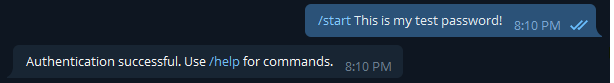
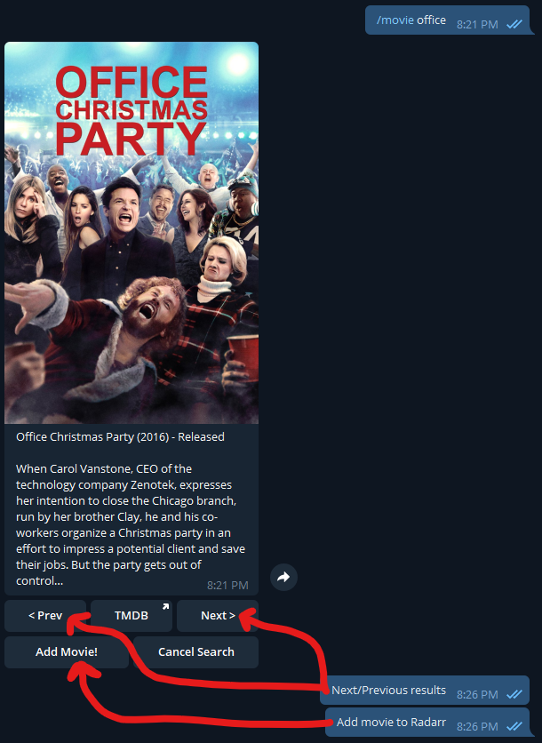
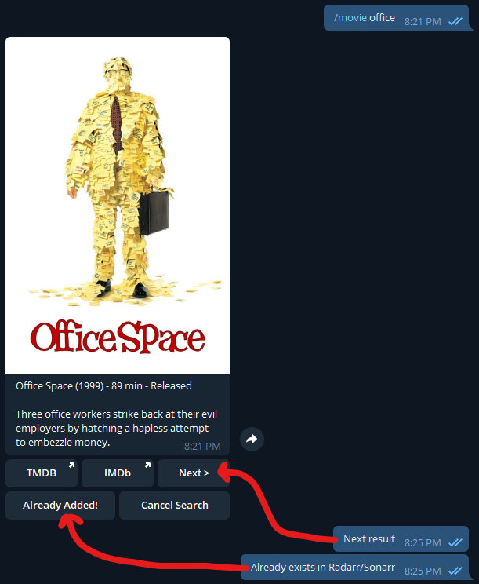
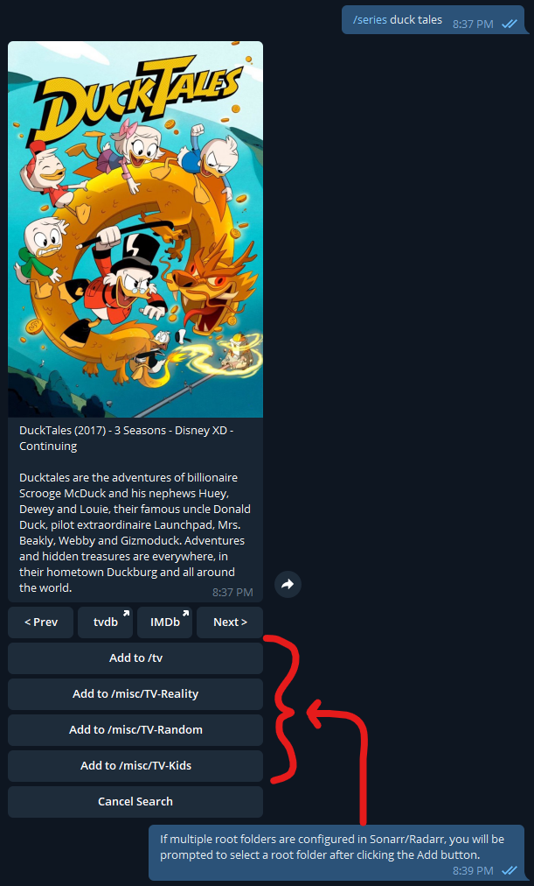
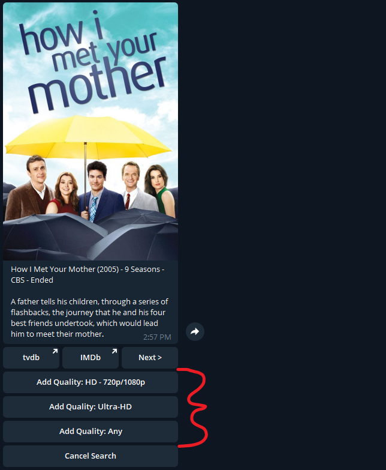
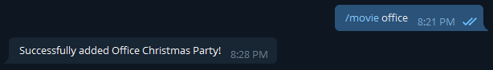

# Searcharr
  
### Sonarr & Radarr Telegram Bot
### By Todd Roberts
https://github.com/toddrob99/searcharr

This bot allows users to add movies to Radarr and series to Sonarr via Telegram messaging app.

## Setup & Run

### Configure

Configure Searcharr with `data/settings.py`, environment variables, or both.

**Environment-variable support is available in 3.5.0-beta.1 on the `beta` branch and the `toddrob/searcharr:beta` image. The stable `latest` image will gain it in the next release.** Existing file-based installations continue to work.

For a settings file, copy `settings-sample.py` to `data/settings.py` and edit its values. For environment-only setup, no settings file is required. Every supported environment variable starts with `SEARCHARR_`, for example `SEARCHARR_TGRAM_TOKEN` and `SEARCHARR_SONARR_URL`. Booleans accept `true/false`; lists use JSON arrays such as `["series","tv"]` or `[]`.

The priority is **environment variables > `data/settings.py` > built-in defaults**. An unset variable falls back; an empty string is an explicit override. Use `[]` for an empty list.

> **Upgrading from a root `settings.py`?** Searcharr automatically copies it into `data/` if `data/settings.py` does not exist. For environment-only migration, rename both copies as backups and remove any old individual settings-file mount. Keep the data volume for the database, then recreate the container to apply environment changes.

Set the Telegram token and each enabled service's URL and API key. Both Sonarr and Radarr default to enabled; disable any unused service. Set a regular-user password and a distinct administrator password if you want password-protected authentication and admin management.

See the [configuration reference](https://github.com/toddrob99/searcharr/wiki/Configuration-::-settings.py) for all settings and defaults, and the [environment-variable guide](https://github.com/toddrob99/searcharr/wiki/Environment-Variables) for naming, Compose examples, and migration.

### Docker & Docker-Compose

Docker is the suggested method to run Searcharr. Be sure to map the following in your Docker container:

* Data folder (database and optional settings) to /app/data
* Log folder to /app/logs

A docker-compose.yml file is provided for your convenience. Update the volume mappings listed above, and then run `docker compose up -d` to start Searcharr.

### Run from Source

If running from source, use Python 3.10+, install requirements using `python -m pip install -r requirements.txt`, and then run `searcharr.py`.

## Use

### Authenticate

Send a private message to your bot saying `/start <password>` where `<password>` is the value of `searcharr_password` in your configuration. For admin access, instead say `/start <admin_password>` where `<admin_password>` is the value of `searcharr_admin_password` in your configuration. An authenticated user can add admin access by re-authenticating using the admin password. Re-authenticating with the non-admin password will not remove a user's admin access. Admin access must be removed by an admin using the `/users` command, or manually in the database.

**Caution**: Authentication via `/start` command will work in a group chat, but then everyone else in the group will see the password. If not all group members should be allowed to use the bot, then be sure to authenticate in a private message.

**Double Caution**: Do not authenticate as an admin in a group chat. Always use a private message with your bot.

### Search & Add a Series to Sonarr or a Movie to Radarr

Send the bot a (private or group) message saying `/series <title>` or `/movie <title>` (replace with custom command aliases, as configured in your configuration). The bot will reply with information about the first result, along with buttons to move forward and back within the search results, pop out to tvdb, TMDB, or IMDb, add the current series/movie to Sonarr/Radarr, or cancel the search. When you click the button to add the series/movie to Sonarr/Radarr, the bot will ask what root folder to put the series/movie in, then what quality profile to use--unless you have only one root folder or quality profile enabled in Searcharr settings, in which case it will skip those steps and add the series/movie straight away.

### Manage Users

If you are authenticated as an admin, you can use the `/users` command to retrieve a list of users with buttons to remove all access and add/remove admin access (as applicable).

## Screenshots

Authenticate by saying `/start <password>` (or `/start@bot_username <password>` in a group with multiple bots)

Search for movie using `/movie <title>` or series using `/series <title>` (behavior is the same for series and movies) (use custom commands configured in your configuration if applicable). Buttons will appear to open the series/movie info in tvdb, IMDb, or TVDB when those ids are available.

If series/movie already exists in Sonarr/Radarr, the Add button will instead say "Already Added!":

If Searcharr has multiple root folders configured, you will be prompted to select a root folder:

If Searcharr has multiple quality profiles configured, you will be prompted to select a quality profile after selecting a root folder:

When the series/movie has been added, or you click Cancel, the search results will be removed:

